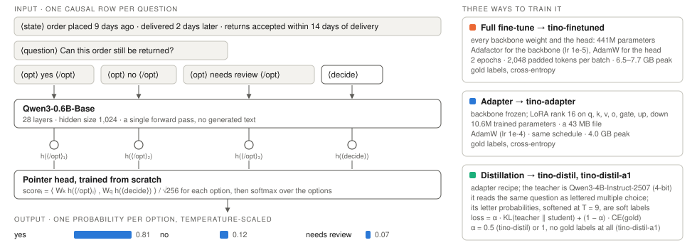
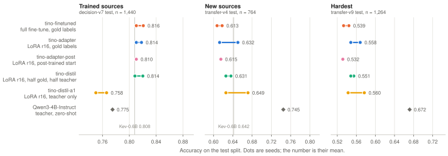
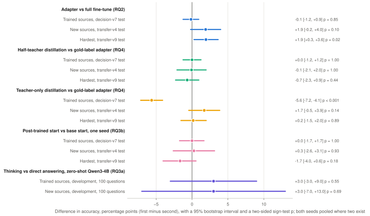
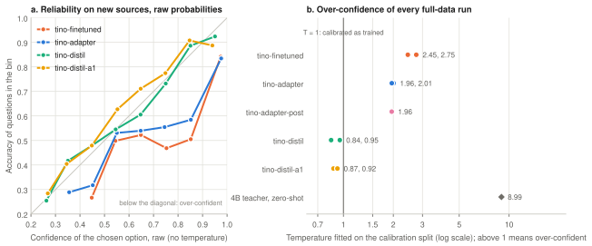
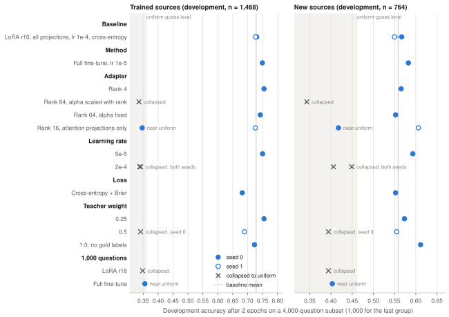
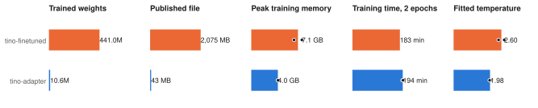
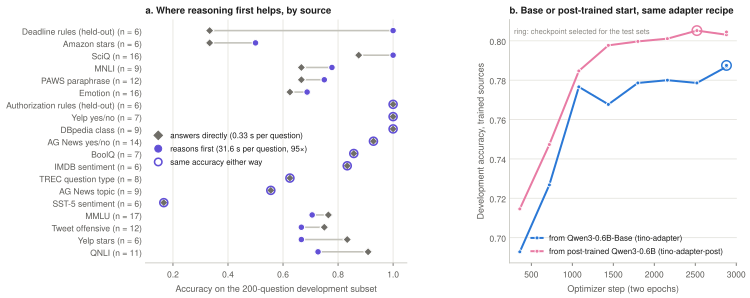
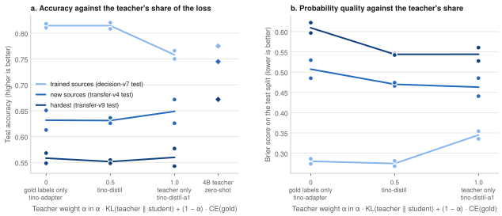
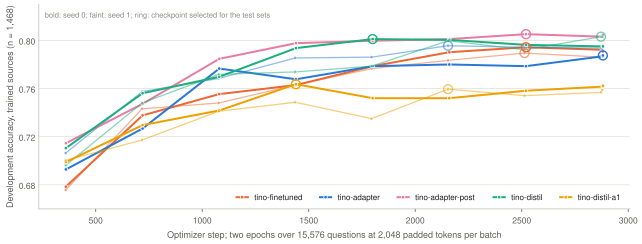

# Small decoders as decision models: full fine-tuning, adapters and distillation from an autoregressive teacher on a 16 GB laptop

Patrick Li · Draft of 28 October 2026 · Code, runs, predictions and figures: [github.com/BrandeisPatrick/tino](https://github.com/BrandeisPatrick/tino)

## Abstract

A decision model answers a typed question about a state with one probability per option in a single forward pass, with no generated text. We ask whether a small autoregressive decoder, Qwen3-0.6B-Base, can be turned into one on a 16 GB Apple M4, and which of three routes works best: full fine-tuning, a LoRA adapter, or distillation from a 4B instruction-tuned teacher. Across 27 tracked training runs (44 hours, two seeds for every claim that matters) the routes tie on trained sources (accuracy 0.81) and differ by less than seed noise on new sources (0.61 to 0.65). The adapter trains 41 times fewer weights in half the memory. The teacher's soft labels change calibration far more than accuracy: every distilled student comes out calibrated as trained (fitted temperature 0.84 to 0.95), while every gold-label student is over-confident (2.0 to 2.75). At small data, training stability is the first-order effect: 5 of 15 adapter runs on 4,000 questions collapsed to a uniform guess. A thinking teacher adds 3 points, not significant, at 95 times the latency. Every run's configuration, logs and per-question predictions are in the repository.

## 1 Introduction

Jev, TypeSafe's "System One" model, is a decision model: it takes a state and typed questions (a choice among options, a score on a scale, a yes-or-no) and returns calibrated probabilities from one forward pass, without generating text. Open re-creations such as Kev showed that the format works on small open backbones. We wanted to know, on one laptop, which of the usual ways of adapting a decoder is best for this job, and whether the probabilities of an ordinary autoregressive model can be distilled into one. Four questions organise the work:

- **RQ1.** Which fine-tuning recipe is best for a decision model?
- **RQ2.** Full fine-tuning or an adapter?
- **RQ3.** Does a thinking model help, as the decider or as the student's starting point?
- **RQ4.** Can an autoregressive model be distilled into a decision model?

## 2 Setup

*Figure 1. The tino decision model and the three ways it was trained. A record's state, question and options are laid out in one causal row, with Qwen's reserved special tokens as delimiters (⟨state⟩ is `<|fim_prefix|>`, ⟨question⟩ `<|fim_middle|>`, ⟨opt⟩…⟨/opt⟩ `<|box_start|>`…`<|box_end|>`, ⟨decide⟩ `<|fim_suffix|>`), so no vocabulary is added. The backbone runs once; a pointer head scores each option's closing-delimiter state against the decide state, and a softmax over the options gives the answer. Full fine-tuning, the adapter and distillation differ only in what is trained and what the loss is.*

Every experiment follows one protocol, so the numbers in every figure are comparable.

| | |
|---|---|
| Student base | `Qwen/Qwen3-0.6B-Base`, revision `da87bfb6` |
| Data | `jaredpalmer/kev-suites`, revision `cc4bac80`, checksums verified. Train on `decision-v7/train`: 15,576 questions from 24 sources. Test on `decision-v7/test` (trained sources, 1,440), `transfer-v4/test` (9 new sources, 764) and `transfer-v9/test` (hardest, 1,264) |
| Teacher | `Qwen3-4B-Instruct-2507`, 4-bit, read zero-shot as lettered multiple choice; its letter probabilities, softened at a fitted temperature of 9.0, are the soft labels |
| Selection | best development accuracy; temperature fitted on the calibration split; test splits read once per released model; ablations judged on development splits only |
| Noise | 95% half-width about ±2.1 points on trained sources and ±3.5 on new sources; the same recipe moved by up to 4.6 points on new sources between seeds, so single-seed gaps under 4 points are not claimed |
| Machine | Apple M4 with 16 GB, MLX; a memory guard pauses a run under 25% free memory and stops it under 12% |
| Tracking | 39 runs; each run's configuration, git provenance, logs, resource trace and per-question predictions are committed in `runs/`; weights on the Hugging Face Hub with pinned revisions |

## 3 Results

### 3.1 Accuracy

*Figure 2. Test accuracy of the five released recipes and the 4B teacher on the three test splits. Each dot is one training seed (two where available); the bar between them is the seed spread and the number is the seed mean. The vertical line is Kev-0.6B, the open decision model of the same size (0.808 trained sources, 0.642 new sources, as reported). On trained sources every gold-label or half-teacher recipe lands on 0.81; the teacher-only student gives up five points. On new sources the spread between seeds of one recipe (up to 4.6 points) is as large as the spread between recipes. The 4B teacher, read zero-shot, stays ahead out of domain.*

### 3.2 Which differences are real

*Figure 3. The comparison behind each research question as a paired difference on the same questions, pooled over both seeds where two exist, with a 95% bootstrap interval and a two-sided sign test. One effect is clearly non-zero: training on the teacher's probabilities alone costs 5.6 points on trained sources. The adapter's lean over full fine-tuning out of domain (+1.9 points on both new-source splits) reaches p = 0.02 on the hardest split, but it is smaller than the 3.8-point gap between the adapter's own two seeds, so we report it as a lean. Everything else is within noise, including reasoning before answering.*

### 3.3 Calibration

*Figure 4. Calibration is what distillation transfers. (a) Reliability on new sources before any temperature scaling, both seeds pooled: the gold-label students sit well below the diagonal (answers given with about 85% confidence are right only 50 to 60% of the time), while the distilled students track it. (b) The temperature each full-data run needs after training: every gold-label run needs 2.0 to 2.75, every distilled run 0.84 to 0.95, so the distilled probabilities can be used as they come. The teacher itself, read zero-shot, needs 9.0.*

### 3.4 RQ1: which recipe

*Figure 5. Recipe ablation on a 4,000-question subset (2 epochs, about an hour per run), one change at a time from the adapter baseline, judged on development splits only. Crosses are runs whose decision head collapsed: every option gets the same score, development log-loss sits at exactly the uniform value (1.478) and the fitted temperature hits its floor. Learning rate 2e-4 collapsed on both seeds and rank 64 with alpha scaled to rank collapsed, because each update is too large; two of the twelve sane configurations also failed on one seed by chance (attention-only and teacher weight 0.5) and trained normally on the other. Among runs that trained, smaller updates (lr 5e-5, rank 4) helped a little on trained sources, attention-only adapters transferred best when they trained, a Brier term hurt, and 1,000 questions were not enough for either method. No adapter run collapsed at full data.*

### 3.5 RQ2: full fine-tune or adapter

*Figure 6. What the two gold-label recipes cost at full data (means of two seeds; seed values as dots where they differ). The adapter trains 41 times fewer weights, publishes a 43 MB file instead of 2.1 GB and peaks at 4.0 GB of memory against 6.5 to 7.7 GB, in the same wall-clock time, because the backward pass still runs through the frozen backbone. The full fine-tune is also the more over-confident of the two. The 7.7 GB peak is seed 0, which ran before a fix to how gradients were evaluated; seed 1 ran after it.*

### 3.6 RQ3: thinking, as the decider and as the starting point

*Figure 7. Thinking in two places. (a) Zero-shot on 200 development questions (100 per suite): Qwen3-4B-Thinking-2507 against Qwen3-4B-Instruct-2507, by source with at least six questions. Reasoning first helps on rule-following records (held-out deadline rules go from 2 of 6 to 6 of 6) and hurts on QNLI and MMLU, for +3.0 points overall, not significant (Figure 3), at 31.6 s per question against 0.33 s. 43 of the 200 reasoning traces hit the 2,048-token cap, so thinking may be slightly understated. (b) As the student's starting point, the post-trained, thinking-capable Qwen3-0.6B learns faster for an epoch and ends where the base model ends; the two are indistinguishable on every test split.*

### 3.7 RQ4: how much of the teacher

*Figure 8. What the teacher's share of the loss buys. (a) Accuracy on the three test splits as the loss moves from gold labels only (tino-adapter) through half teacher (tino-distil) to teacher only (tino-distil-a1), two seeds per point; diamonds are the 4B teacher itself. On trained sources the teacher-only student drops to the teacher's own level; on new sources it gains at most a point or two and stays well below the teacher. (b) Brier score on the same splits: the teacher's probabilities improve probability quality out of domain even where accuracy is flat.*

### 3.8 Training dynamics

*Figure 9. Development accuracy during the seven full-data runs. The full fine-tune and the adapter learn at the same pace; the post-trained start leads through the first epoch and then converges; the teacher-only student plateaus about four points lower. Rings mark the checkpoint selected for the test sets, the one with the best development accuracy.*

## 4 What we learned

1. **Stability first.** At small data the biggest effect is whether training works at all: learning rate at or below 1e-4, alpha fixed rather than scaled with rank, at least two seeds, and reject any run whose development log-loss sits at the uniform value.
2. **The adapter is the default.** Same accuracy as full fine-tuning on trained sources, a lean ahead on new sources, 41 times fewer trained weights and half the memory. Full fine-tuning is the safer choice only with a few thousand questions, where it led by 1.5 to 2 points and never collapsed.
3. **Distillation transfers calibration, not accuracy.** Half teacher, half gold labels matches gold-label accuracy everywhere and comes out calibrated without a temperature. Teacher-only training works, at 87% of the teacher's out-of-domain accuracy in a model a sixth of its size and seven times faster, but costs 5.6 points in domain for an out-of-domain gain that two seeds did not confirm.
4. **Thinking is not worth 95 times the latency here**, and a thinking-capable starting point makes no difference once the decision head is trained.
5. **Seed noise is larger than most method differences out of domain.** Two seeds per claim, paired tests on the same questions, and no claim from a single-seed gap under about 4 points.
6. **Plain cross-entropy, rank 16, all projections** is the right default; more rank and a Brier term did not help.

## 5 Limitations

- One backbone size (0.6B) and one data family (kev-suites). Whether the ordering holds at 1.7B or 4B, or on a user's own records, is untested.
- The teacher's own probabilities are badly over-confident (it needs a temperature of 9.0 before they are usable), so the distillation target is as much the fitted temperature as the teacher.
- Most ablation cells have one seed; only the baseline and the three configurations that collapsed were rerun.
- Distilling from the thinking teacher was out of reach on this machine (about 60 hours of generation for the training set), so RQ3 measures the thinking model as a decider, not as a teacher.

## 6 Reproducibility

Every number in this draft is read from the repository: `docs/results.json` (one record per run, generated from the run directories) and the per-question prediction files under `runs/<id>/predictions/`. The figures regenerate with `uv run python scripts/figures.py` and this page with `uv run python scripts/build_article.py`. Training refuses to start from uncommitted code, each run records the commit it ran from, and the five released models were downloaded back from the Hub and re-scored before release; all five reproduce their test accuracy exactly. The research log with every experiment is `RESEARCH.md`; the day-by-day account is `docs/TIMELINE.md`.

| Model | Recipe | Trained sources | New sources | Hardest | Temperature | File |
|---|---|---:|---:|---:|---:|---:|
| [tino-finetuned](https://huggingface.co/BrandeisPatrick/tino-finetuned) | full fine-tune, gold labels | 0.810 | 0.618 | 0.544 | 2.45 | 2.1 GB |
| [tino-adapter](https://huggingface.co/BrandeisPatrick/tino-adapter) | LoRA r16, gold labels | 0.810 | 0.613 | 0.548 | 2.01 | 43 MB |
| [tino-adapter-post](https://huggingface.co/BrandeisPatrick/tino-adapter-post) | LoRA r16 from post-trained Qwen3-0.6B | 0.810 | 0.615 | 0.532 | 1.96 | 43 MB |
| [tino-distil](https://huggingface.co/BrandeisPatrick/tino-distil) | LoRA r16, half gold, half teacher | 0.808 | 0.636 | 0.555 | 0.95 | 43 MB |
| [tino-distil-a1](https://huggingface.co/BrandeisPatrick/tino-distil-a1) | LoRA r16, teacher only | 0.750 | 0.671 | 0.577 | 0.87 | 43 MB |

*Table 1. The released models (seed 0 of each recipe) on the three test splits, with the temperature each needs and the size of the published weights. Second seeds are tracked runs; their numbers are the second dots in Figure 2.*
